<div align="center">

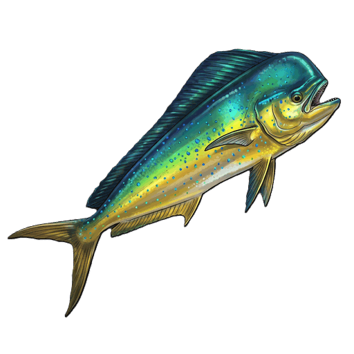

# cartier_gta6_fishes

GTA VI style fish icons for FiveM inventories, by **Costa Cartier**.


[Preview](#preview) · [ox_inventory](#ox_inventory) · [qb-inventory](#qb-inventory) · [Item list](#item-list)

</div>

## About

33 fish icons as 512×512 PNGs with transparent backgrounds. Every file is named after its item, so the icons work without any renaming. Item definitions for ox_inventory and qb-inventory are included below.

## Preview

<table>
<tr><td align="center" width="25%">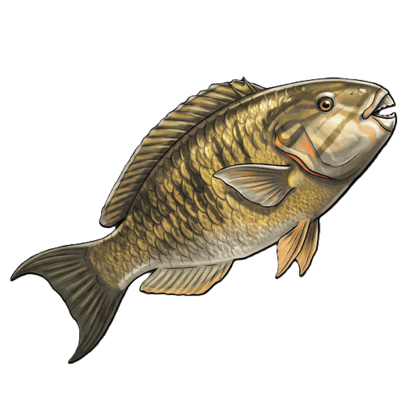<br><sub><b>Achigan</b></sub><br><sub><code>achigan</code></sub></td><td align="center" width="25%">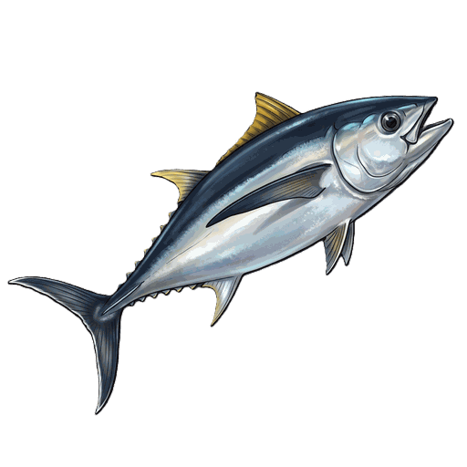<br><sub><b>Albacore Tuna</b></sub><br><sub><code>albacore_tuna</code></sub></td><td align="center" width="25%">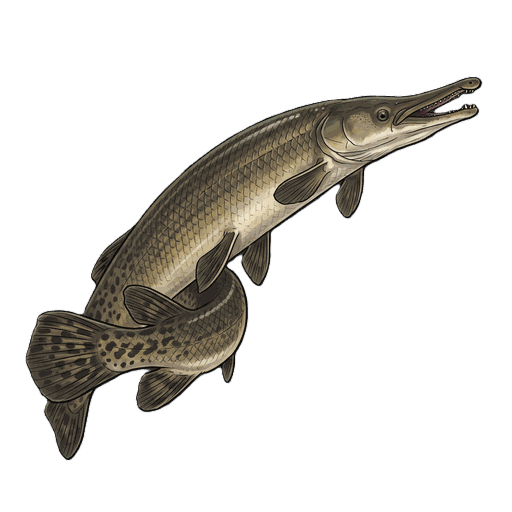<br><sub><b>Alligator Gar</b></sub><br><sub><code>alligator_gar</code></sub></td><td align="center" width="25%">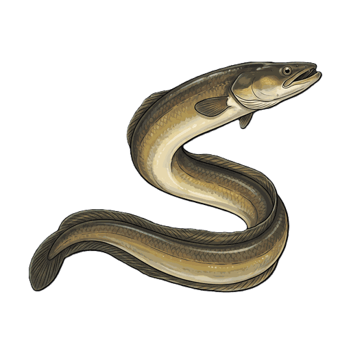<br><sub><b>American Eel</b></sub><br><sub><code>american_eel</code></sub></td></tr>
<tr><td align="center" width="25%">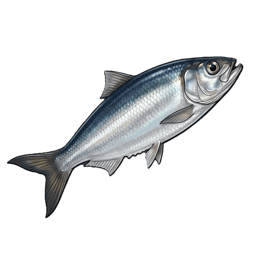<br><sub><b>Atlantic Herring</b></sub><br><sub><code>atlantic_herring</code></sub></td><td align="center" width="25%">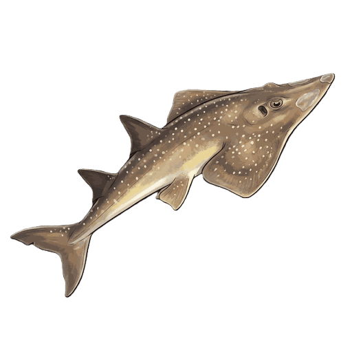<br><sub><b>Atlantic Shovelfish</b></sub><br><sub><code>atlantic_shovelfish</code></sub></td><td align="center" width="25%">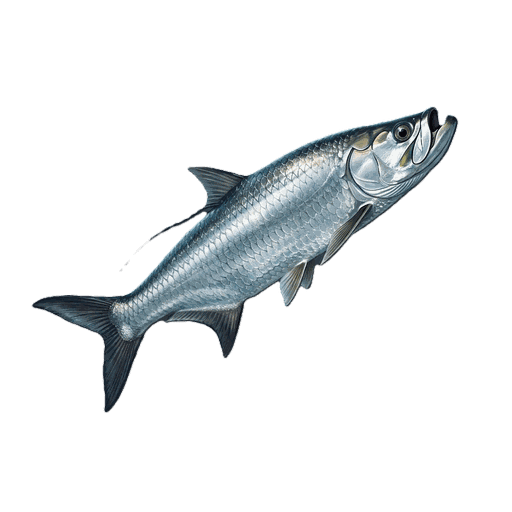<br><sub><b>Atlantic Tarpon</b></sub><br><sub><code>atlantic_tarpon</code></sub></td><td align="center" width="25%">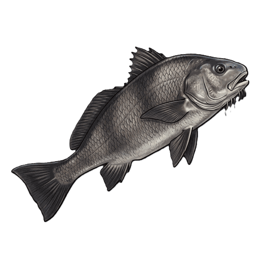<br><sub><b>Black Drum</b></sub><br><sub><code>black_drum</code></sub></td></tr>
<tr><td align="center" width="25%">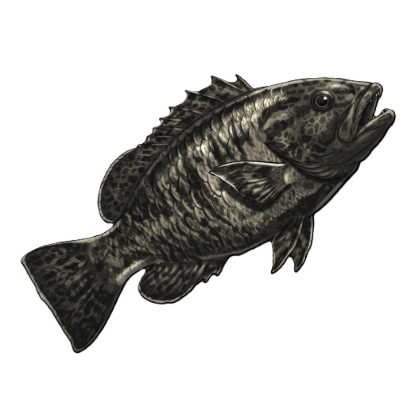<br><sub><b>Black Grouper</b></sub><br><sub><code>black_grouper</code></sub></td><td align="center" width="25%">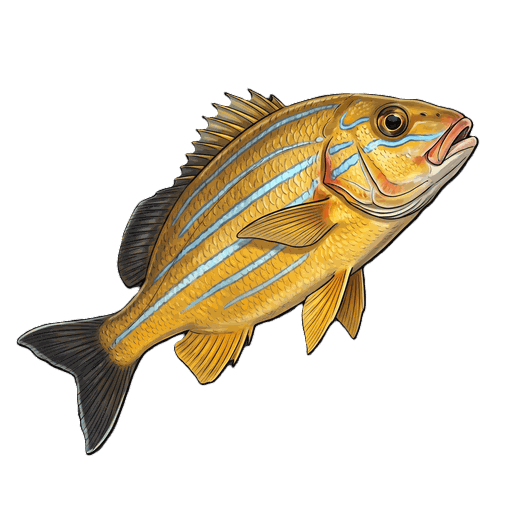<br><sub><b>Blue Stripe Snorer</b></sub><br><sub><code>blue_stripe_snorer</code></sub></td><td align="center" width="25%">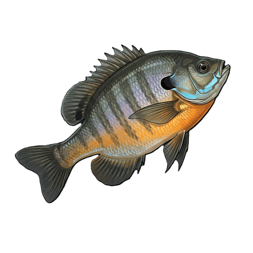<br><sub><b>Bluegill</b></sub><br><sub><code>bluegill</code></sub></td><td align="center" width="25%">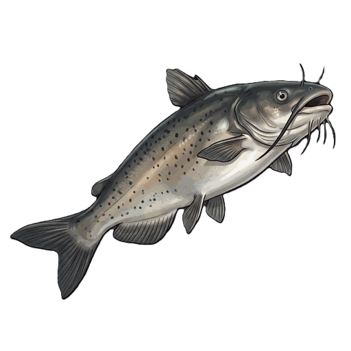<br><sub><b>Channel Catfish</b></sub><br><sub><code>channel_catfish</code></sub></td></tr>
<tr><td align="center" width="25%">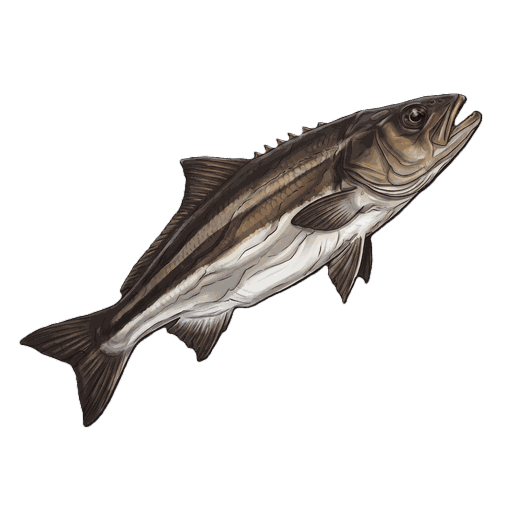<br><sub><b>Cobia</b></sub><br><sub><code>cobia</code></sub></td><td align="center" width="25%">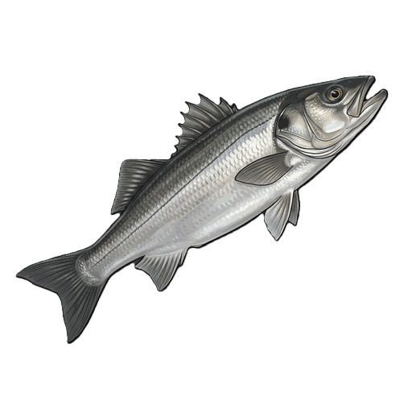<br><sub><b>Common Sea Bass</b></sub><br><sub><code>common_sea_bass</code></sub></td><td align="center" width="25%">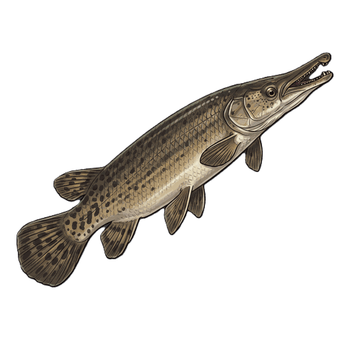<br><sub><b>Florida Gar</b></sub><br><sub><code>florida_gar</code></sub></td><td align="center" width="25%">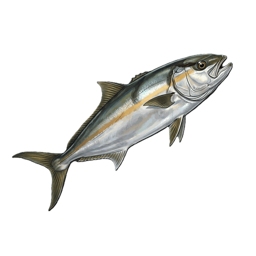<br><sub><b>Great Amberjack</b></sub><br><sub><code>great_amberjack</code></sub></td></tr>
<tr><td align="center" width="25%">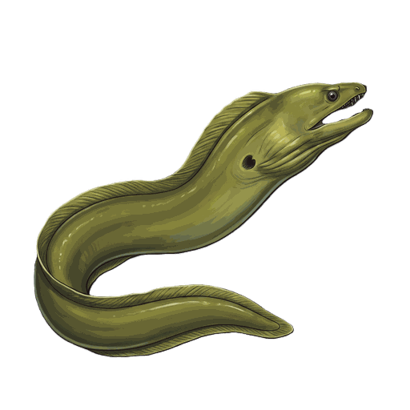<br><sub><b>Green Moray Eel</b></sub><br><sub><code>green_moray_eel</code></sub></td><td align="center" width="25%">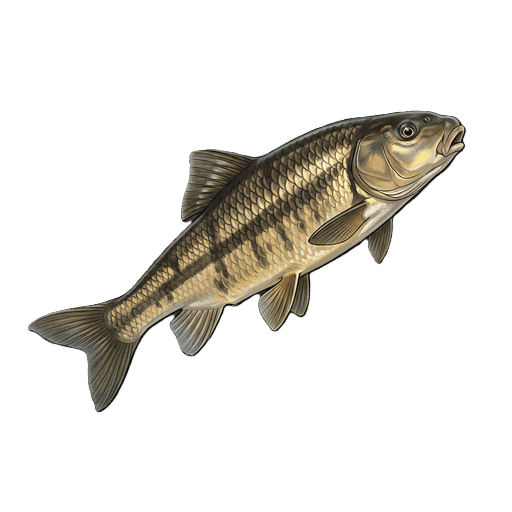<br><sub><b>Lake Chubsucker</b></sub><br><sub><code>lake_chubsucker</code></sub></td><td align="center" width="25%"><br><sub><b>Mahi-Mahi</b></sub><br><sub><code>mahi_mahi</code></sub></td><td align="center" width="25%">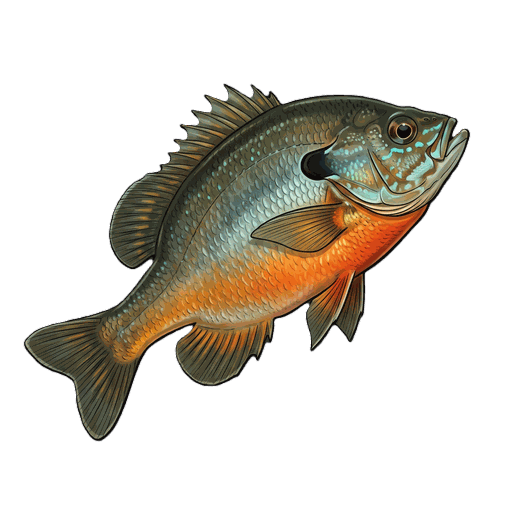<br><sub><b>Red Breasted Sunfish</b></sub><br><sub><code>red_breasted_sunfish</code></sub></td></tr>
<tr><td align="center" width="25%">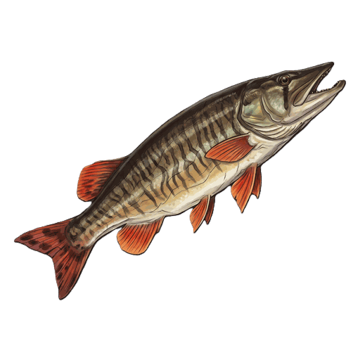<br><sub><b>Red Finned Pike</b></sub><br><sub><code>red_finned_pike</code></sub></td><td align="center" width="25%">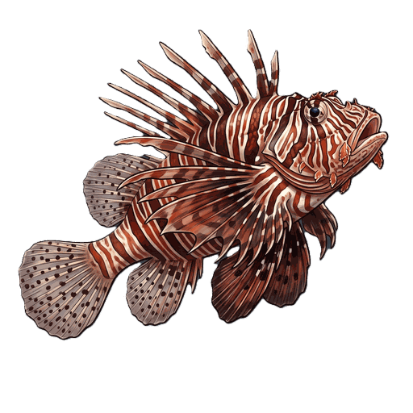<br><sub><b>Red Lionfish</b></sub><br><sub><code>red_lionfish</code></sub></td><td align="center" width="25%">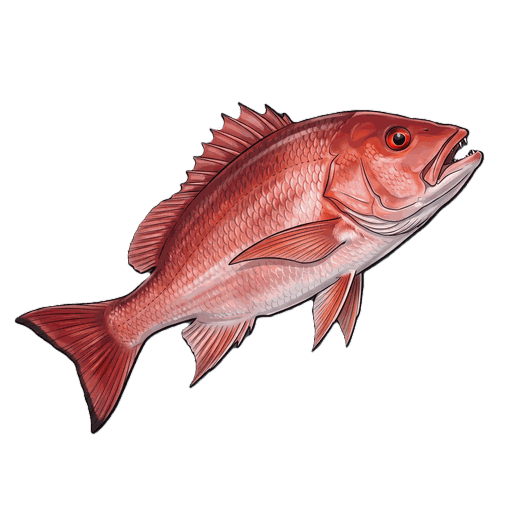<br><sub><b>Red Snapper</b></sub><br><sub><code>red_snapper</code></sub></td><td align="center" width="25%">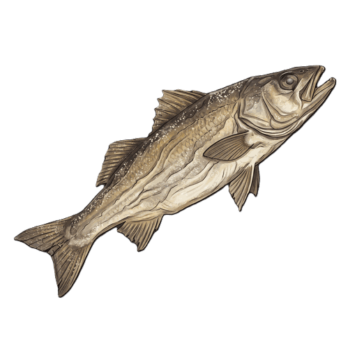<br><sub><b>Salted Fish</b></sub><br><sub><code>salted_fish</code></sub></td></tr>
<tr><td align="center" width="25%">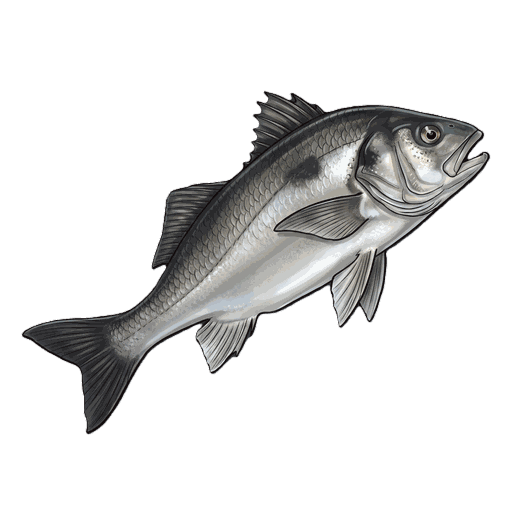<br><sub><b>Sea Bass</b></sub><br><sub><code>sea_bass</code></sub></td><td align="center" width="25%">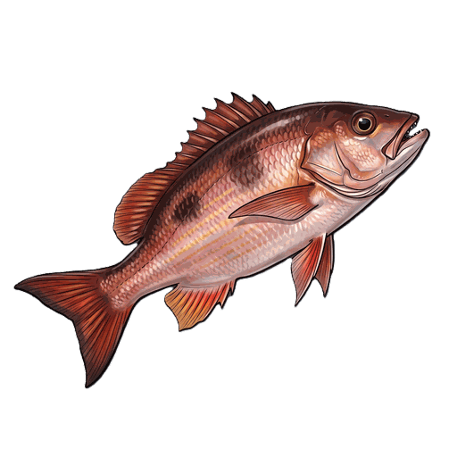<br><sub><b>Small Headed Snapper</b></sub><br><sub><code>small_headed_snapper</code></sub></td><td align="center" width="25%">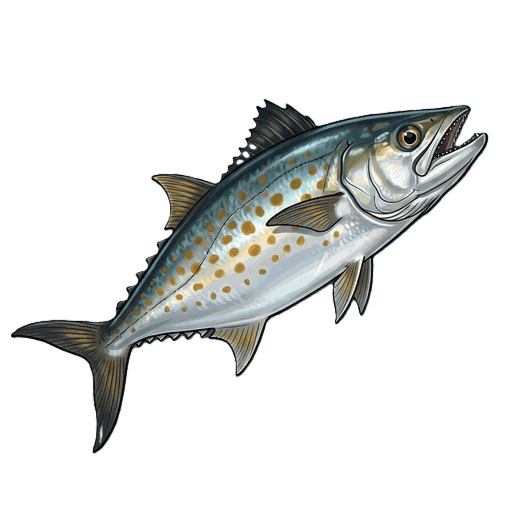<br><sub><b>Spanish Mackerel</b></sub><br><sub><code>spanish_mackerel</code></sub></td><td align="center" width="25%">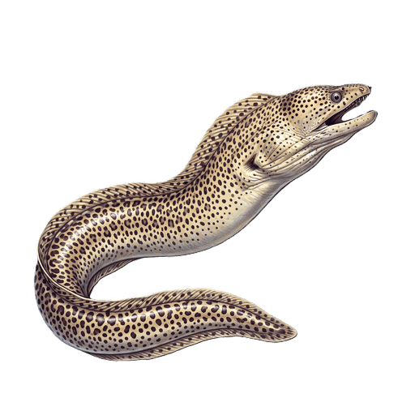<br><sub><b>Spotted Moray Eel</b></sub><br><sub><code>spotted_moray_eel</code></sub></td></tr>
<tr><td align="center" width="25%">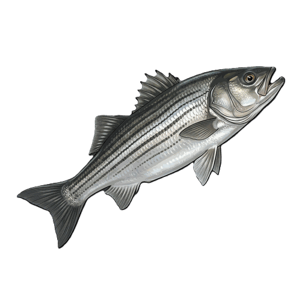<br><sub><b>Striped Sea Bass</b></sub><br><sub><code>striped_sea_bass</code></sub></td><td align="center" width="25%">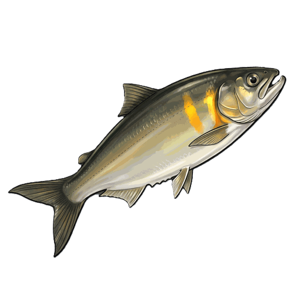<br><sub><b>Sweetfish</b></sub><br><sub><code>sweetfish</code></sub></td><td align="center" width="25%">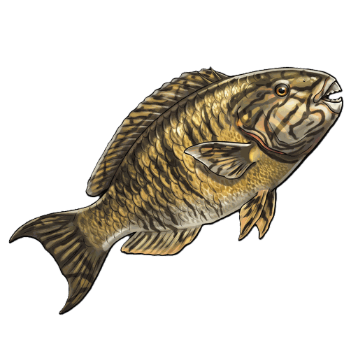<br><sub><b>Tiger Grouper</b></sub><br><sub><code>tiger_grouper</code></sub></td><td align="center" width="25%">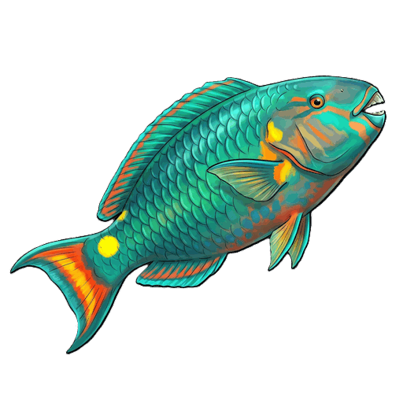<br><sub><b>Traffic Light Parrotfish</b></sub><br><sub><code>traffic_light_parrotfish</code></sub></td></tr>
<tr><td align="center" width="25%">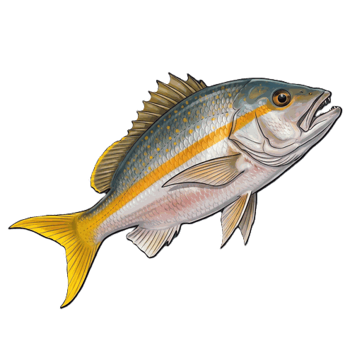<br><sub><b>Yellow Tailed Snapper</b></sub><br><sub><code>yellow_tailed_snapper</code></sub></td></tr>
</table>

## ox_inventory

1. Copy the contents of [`images/`](images) into `ox_inventory/web/images/`.
2. Open `ox_inventory/data/items.lua` and paste the entries below into the `return { ... }` table. The same code is in [`ox_inventory/items.lua`](ox_inventory/items.lua).
3. Restart `ox_inventory`.

<details>
<summary><b>ox_inventory items</b></summary>

```lua
	['achigan'] = {
		label = 'Achigan',
		weight = 1800,
		stack = true,
		close = true,
		description = 'A feisty freshwater black bass.',
	},

	['albacore_tuna'] = {
		label = 'Albacore Tuna',
		weight = 9000,
		stack = true,
		close = true,
		description = 'A fast, silver-blue ocean tuna.',
	},

	['alligator_gar'] = {
		label = 'Alligator Gar',
		weight = 12000,
		stack = true,
		close = true,
		description = 'A prehistoric river giant with a toothy snout.',
	},

	['american_eel'] = {
		label = 'American Eel',
		weight = 1500,
		stack = true,
		close = true,
		description = 'A slippery, snake-like eel.',
	},

	['atlantic_herring'] = {
		label = 'Atlantic Herring',
		weight = 400,
		stack = true,
		close = true,
		description = 'A small, silvery schooling fish.',
	},

	['atlantic_shovelfish'] = {
		label = 'Atlantic Shovelfish',
		weight = 2500,
		stack = true,
		close = true,
		description = 'A flat-snouted bottom dweller.',
	},

	['atlantic_tarpon'] = {
		label = 'Atlantic Tarpon',
		weight = 15000,
		stack = true,
		close = true,
		description = 'The silver king of the coast.',
	},

	['black_drum'] = {
		label = 'Black Drum',
		weight = 6000,
		stack = true,
		close = true,
		description = 'A heavy, croaking bottom feeder.',
	},

	['black_grouper'] = {
		label = 'Black Grouper',
		weight = 8000,
		stack = true,
		close = true,
		description = 'A big reef grouper with dark blotches.',
	},

	['blue_stripe_snorer'] = {
		label = 'Blue Stripe Snorer',
		weight = 900,
		stack = true,
		close = true,
		description = 'A colorful reef fish with blue stripes.',
	},

	['bluegill'] = {
		label = 'Bluegill',
		weight = 300,
		stack = true,
		close = true,
		description = 'A small, classic pond sunfish.',
	},

	['channel_catfish'] = {
		label = 'Channel Catfish',
		weight = 3500,
		stack = true,
		close = true,
		description = 'A whiskered freshwater catfish.',
	},

	['cobia'] = {
		label = 'Cobia',
		weight = 7000,
		stack = true,
		close = true,
		description = 'A powerful, shark-like coastal fish.',
	},

	['common_sea_bass'] = {
		label = 'Common Sea Bass',
		weight = 1500,
		stack = true,
		close = true,
		description = 'A popular, tasty sea bass.',
	},

	['florida_gar'] = {
		label = 'Florida Gar',
		weight = 2500,
		stack = true,
		close = true,
		description = 'A spotted gar from swampy waters.',
	},

	['great_amberjack'] = {
		label = 'Great Amberjack',
		weight = 10000,
		stack = true,
		close = true,
		description = 'A strong, hard-fighting reef jack.',
	},

	['green_moray_eel'] = {
		label = 'Green Moray Eel',
		weight = 5000,
		stack = true,
		close = true,
		description = 'A large green eel hiding in reefs.',
	},

	['lake_chubsucker'] = {
		label = 'Lake Chubsucker',
		weight = 500,
		stack = true,
		close = true,
		description = 'A small, olive-colored lake fish.',
	},

	['mahi_mahi'] = {
		label = 'Mahi-Mahi',
		weight = 6000,
		stack = true,
		close = true,
		description = 'A vibrant green-gold ocean fish.',
	},

	['red_breasted_sunfish'] = {
		label = 'Red Breasted Sunfish',
		weight = 400,
		stack = true,
		close = true,
		description = 'A sunfish with a bright orange belly.',
	},

	['red_finned_pike'] = {
		label = 'Red Finned Pike',
		weight = 3000,
		stack = true,
		close = true,
		description = 'A predatory pike with red fins.',
	},

	['red_lionfish'] = {
		label = 'Red Lionfish',
		weight = 800,
		stack = true,
		close = true,
		description = 'Venomous spines - handle with care.',
	},

	['red_snapper'] = {
		label = 'Red Snapper',
		weight = 3000,
		stack = true,
		close = true,
		description = 'A prized, rosy-red reef fish.',
	},

	['salted_fish'] = {
		label = 'Salted Fish',
		weight = 500,
		stack = true,
		close = true,
		description = 'Fish preserved in salt. Lasts a long time.',
	},

	['sea_bass'] = {
		label = 'Sea Bass',
		weight = 1800,
		stack = true,
		close = true,
		description = 'A versatile and common sea bass.',
	},

	['small_headed_snapper'] = {
		label = 'Small Headed Snapper',
		weight = 1200,
		stack = true,
		close = true,
		description = 'A snapper with a petite head.',
	},

	['spanish_mackerel'] = {
		label = 'Spanish Mackerel',
		weight = 1500,
		stack = true,
		close = true,
		description = 'A sleek, spotted mackerel.',
	},

	['spotted_moray_eel'] = {
		label = 'Spotted Moray Eel',
		weight = 4000,
		stack = true,
		close = true,
		description = 'A moray covered in dark spots.',
	},

	['striped_sea_bass'] = {
		label = 'Striped Sea Bass',
		weight = 4000,
		stack = true,
		close = true,
		description = 'A sea bass with bold stripes.',
	},

	['sweetfish'] = {
		label = 'Sweetfish',
		weight = 200,
		stack = true,
		close = true,
		description = 'A small river fish with a sweet taste.',
	},

	['tiger_grouper'] = {
		label = 'Tiger Grouper',
		weight = 4500,
		stack = true,
		close = true,
		description = 'A grouper with tiger-like patterns.',
	},

	['traffic_light_parrotfish'] = {
		label = 'Traffic Light Parrotfish',
		weight = 1200,
		stack = true,
		close = true,
		description = 'A parrotfish in red, yellow and green.',
	},

	['yellow_tailed_snapper'] = {
		label = 'Yellow Tailed Snapper',
		weight = 1000,
		stack = true,
		close = true,
		description = 'A snapper with a bright yellow tail.',
	},
```

</details>

## qb-inventory

1. Copy the contents of [`images/`](images) into `qb-inventory/html/images/`.
2. Open `qb-core/shared/items.lua` and paste the entries below into the `QBShared.Items = { ... }` table. The same code is in [`qb-inventory/items.lua`](qb-inventory/items.lua).
3. Restart `qb-core` and `qb-inventory`.

<details>
<summary><b>qb-inventory items</b></summary>

```lua
    achigan                  = { name = 'achigan', label = 'Achigan', weight = 1800, type = 'item', image = 'achigan.png', unique = false, useable = false, shouldClose = true, description = 'A feisty freshwater black bass.' },
    albacore_tuna            = { name = 'albacore_tuna', label = 'Albacore Tuna', weight = 9000, type = 'item', image = 'albacore_tuna.png', unique = false, useable = false, shouldClose = true, description = 'A fast, silver-blue ocean tuna.' },
    alligator_gar            = { name = 'alligator_gar', label = 'Alligator Gar', weight = 12000, type = 'item', image = 'alligator_gar.png', unique = false, useable = false, shouldClose = true, description = 'A prehistoric river giant with a toothy snout.' },
    american_eel             = { name = 'american_eel', label = 'American Eel', weight = 1500, type = 'item', image = 'american_eel.png', unique = false, useable = false, shouldClose = true, description = 'A slippery, snake-like eel.' },
    atlantic_herring         = { name = 'atlantic_herring', label = 'Atlantic Herring', weight = 400, type = 'item', image = 'atlantic_herring.png', unique = false, useable = false, shouldClose = true, description = 'A small, silvery schooling fish.' },
    atlantic_shovelfish      = { name = 'atlantic_shovelfish', label = 'Atlantic Shovelfish', weight = 2500, type = 'item', image = 'atlantic_shovelfish.png', unique = false, useable = false, shouldClose = true, description = 'A flat-snouted bottom dweller.' },
    atlantic_tarpon          = { name = 'atlantic_tarpon', label = 'Atlantic Tarpon', weight = 15000, type = 'item', image = 'atlantic_tarpon.png', unique = false, useable = false, shouldClose = true, description = 'The silver king of the coast.' },
    black_drum               = { name = 'black_drum', label = 'Black Drum', weight = 6000, type = 'item', image = 'black_drum.png', unique = false, useable = false, shouldClose = true, description = 'A heavy, croaking bottom feeder.' },
    black_grouper            = { name = 'black_grouper', label = 'Black Grouper', weight = 8000, type = 'item', image = 'black_grouper.png', unique = false, useable = false, shouldClose = true, description = 'A big reef grouper with dark blotches.' },
    blue_stripe_snorer       = { name = 'blue_stripe_snorer', label = 'Blue Stripe Snorer', weight = 900, type = 'item', image = 'blue_stripe_snorer.png', unique = false, useable = false, shouldClose = true, description = 'A colorful reef fish with blue stripes.' },
    bluegill                 = { name = 'bluegill', label = 'Bluegill', weight = 300, type = 'item', image = 'bluegill.png', unique = false, useable = false, shouldClose = true, description = 'A small, classic pond sunfish.' },
    channel_catfish          = { name = 'channel_catfish', label = 'Channel Catfish', weight = 3500, type = 'item', image = 'channel_catfish.png', unique = false, useable = false, shouldClose = true, description = 'A whiskered freshwater catfish.' },
    cobia                    = { name = 'cobia', label = 'Cobia', weight = 7000, type = 'item', image = 'cobia.png', unique = false, useable = false, shouldClose = true, description = 'A powerful, shark-like coastal fish.' },
    common_sea_bass          = { name = 'common_sea_bass', label = 'Common Sea Bass', weight = 1500, type = 'item', image = 'common_sea_bass.png', unique = false, useable = false, shouldClose = true, description = 'A popular, tasty sea bass.' },
    florida_gar              = { name = 'florida_gar', label = 'Florida Gar', weight = 2500, type = 'item', image = 'florida_gar.png', unique = false, useable = false, shouldClose = true, description = 'A spotted gar from swampy waters.' },
    great_amberjack          = { name = 'great_amberjack', label = 'Great Amberjack', weight = 10000, type = 'item', image = 'great_amberjack.png', unique = false, useable = false, shouldClose = true, description = 'A strong, hard-fighting reef jack.' },
    green_moray_eel          = { name = 'green_moray_eel', label = 'Green Moray Eel', weight = 5000, type = 'item', image = 'green_moray_eel.png', unique = false, useable = false, shouldClose = true, description = 'A large green eel hiding in reefs.' },
    lake_chubsucker          = { name = 'lake_chubsucker', label = 'Lake Chubsucker', weight = 500, type = 'item', image = 'lake_chubsucker.png', unique = false, useable = false, shouldClose = true, description = 'A small, olive-colored lake fish.' },
    mahi_mahi                = { name = 'mahi_mahi', label = 'Mahi-Mahi', weight = 6000, type = 'item', image = 'mahi_mahi.png', unique = false, useable = false, shouldClose = true, description = 'A vibrant green-gold ocean fish.' },
    red_breasted_sunfish     = { name = 'red_breasted_sunfish', label = 'Red Breasted Sunfish', weight = 400, type = 'item', image = 'red_breasted_sunfish.png', unique = false, useable = false, shouldClose = true, description = 'A sunfish with a bright orange belly.' },
    red_finned_pike          = { name = 'red_finned_pike', label = 'Red Finned Pike', weight = 3000, type = 'item', image = 'red_finned_pike.png', unique = false, useable = false, shouldClose = true, description = 'A predatory pike with red fins.' },
    red_lionfish             = { name = 'red_lionfish', label = 'Red Lionfish', weight = 800, type = 'item', image = 'red_lionfish.png', unique = false, useable = false, shouldClose = true, description = 'Venomous spines - handle with care.' },
    red_snapper              = { name = 'red_snapper', label = 'Red Snapper', weight = 3000, type = 'item', image = 'red_snapper.png', unique = false, useable = false, shouldClose = true, description = 'A prized, rosy-red reef fish.' },
    salted_fish              = { name = 'salted_fish', label = 'Salted Fish', weight = 500, type = 'item', image = 'salted_fish.png', unique = false, useable = false, shouldClose = true, description = 'Fish preserved in salt. Lasts a long time.' },
    sea_bass                 = { name = 'sea_bass', label = 'Sea Bass', weight = 1800, type = 'item', image = 'sea_bass.png', unique = false, useable = false, shouldClose = true, description = 'A versatile and common sea bass.' },
    small_headed_snapper     = { name = 'small_headed_snapper', label = 'Small Headed Snapper', weight = 1200, type = 'item', image = 'small_headed_snapper.png', unique = false, useable = false, shouldClose = true, description = 'A snapper with a petite head.' },
    spanish_mackerel         = { name = 'spanish_mackerel', label = 'Spanish Mackerel', weight = 1500, type = 'item', image = 'spanish_mackerel.png', unique = false, useable = false, shouldClose = true, description = 'A sleek, spotted mackerel.' },
    spotted_moray_eel        = { name = 'spotted_moray_eel', label = 'Spotted Moray Eel', weight = 4000, type = 'item', image = 'spotted_moray_eel.png', unique = false, useable = false, shouldClose = true, description = 'A moray covered in dark spots.' },
    striped_sea_bass         = { name = 'striped_sea_bass', label = 'Striped Sea Bass', weight = 4000, type = 'item', image = 'striped_sea_bass.png', unique = false, useable = false, shouldClose = true, description = 'A sea bass with bold stripes.' },
    sweetfish                = { name = 'sweetfish', label = 'Sweetfish', weight = 200, type = 'item', image = 'sweetfish.png', unique = false, useable = false, shouldClose = true, description = 'A small river fish with a sweet taste.' },
    tiger_grouper            = { name = 'tiger_grouper', label = 'Tiger Grouper', weight = 4500, type = 'item', image = 'tiger_grouper.png', unique = false, useable = false, shouldClose = true, description = 'A grouper with tiger-like patterns.' },
    traffic_light_parrotfish = { name = 'traffic_light_parrotfish', label = 'Traffic Light Parrotfish', weight = 1200, type = 'item', image = 'traffic_light_parrotfish.png', unique = false, useable = false, shouldClose = true, description = 'A parrotfish in red, yellow and green.' },
    yellow_tailed_snapper    = { name = 'yellow_tailed_snapper', label = 'Yellow Tailed Snapper', weight = 1000, type = 'item', image = 'yellow_tailed_snapper.png', unique = false, useable = false, shouldClose = true, description = 'A snapper with a bright yellow tail.' },
```

</details>

## Item list

<details>
<summary><b>All 33 items</b></summary>

| Item | Label | Weight |
|:--|:--|--:|
| `achigan` | Achigan | 1.8 kg |
| `albacore_tuna` | Albacore Tuna | 9 kg |
| `alligator_gar` | Alligator Gar | 12 kg |
| `american_eel` | American Eel | 1.5 kg |
| `atlantic_herring` | Atlantic Herring | 0.4 kg |
| `atlantic_shovelfish` | Atlantic Shovelfish | 2.5 kg |
| `atlantic_tarpon` | Atlantic Tarpon | 15 kg |
| `black_drum` | Black Drum | 6 kg |
| `black_grouper` | Black Grouper | 8 kg |
| `blue_stripe_snorer` | Blue Stripe Snorer | 0.9 kg |
| `bluegill` | Bluegill | 0.3 kg |
| `channel_catfish` | Channel Catfish | 3.5 kg |
| `cobia` | Cobia | 7 kg |
| `common_sea_bass` | Common Sea Bass | 1.5 kg |
| `florida_gar` | Florida Gar | 2.5 kg |
| `great_amberjack` | Great Amberjack | 10 kg |
| `green_moray_eel` | Green Moray Eel | 5 kg |
| `lake_chubsucker` | Lake Chubsucker | 0.5 kg |
| `mahi_mahi` | Mahi-Mahi | 6 kg |
| `red_breasted_sunfish` | Red Breasted Sunfish | 0.4 kg |
| `red_finned_pike` | Red Finned Pike | 3 kg |
| `red_lionfish` | Red Lionfish | 0.8 kg |
| `red_snapper` | Red Snapper | 3 kg |
| `salted_fish` | Salted Fish | 0.5 kg |
| `sea_bass` | Sea Bass | 1.8 kg |
| `small_headed_snapper` | Small Headed Snapper | 1.2 kg |
| `spanish_mackerel` | Spanish Mackerel | 1.5 kg |
| `spotted_moray_eel` | Spotted Moray Eel | 4 kg |
| `striped_sea_bass` | Striped Sea Bass | 4 kg |
| `sweetfish` | Sweetfish | 0.2 kg |
| `tiger_grouper` | Tiger Grouper | 4.5 kg |
| `traffic_light_parrotfish` | Traffic Light Parrotfish | 1.2 kg |
| `yellow_tailed_snapper` | Yellow Tailed Snapper | 1 kg |

</details>

Weights are in grams. Adjust weights and descriptions to fit your server.

## Structure

```
cartier_gta6_fishes/
├── images/            # 33 PNG icons, 512×512
├── ox_inventory/
│   └── items.lua
├── qb-inventory/
│   └── items.lua
└── README.md
```

## License

Free to use on your FiveM server. Credit is appreciated. Please don't resell the icons.

Made by Costa Cartier.
